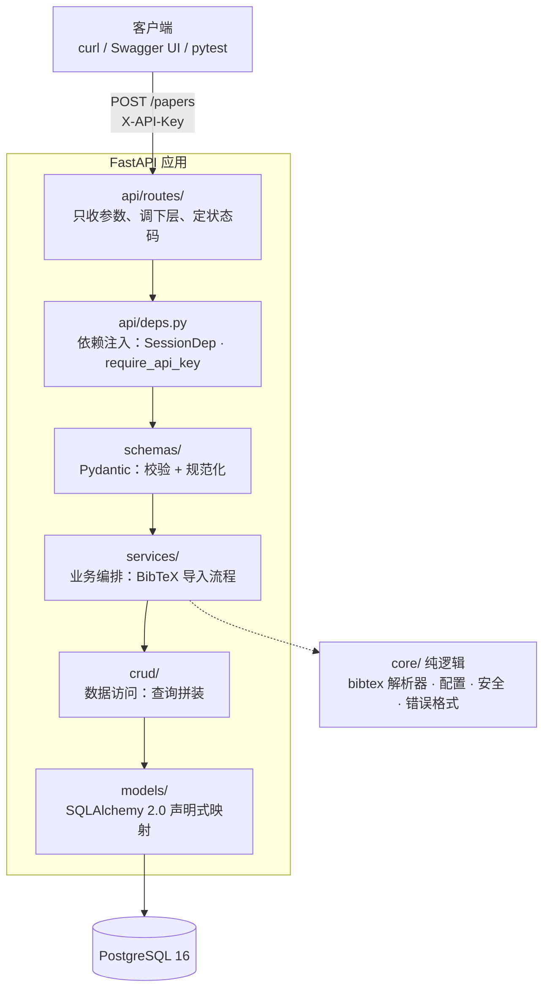
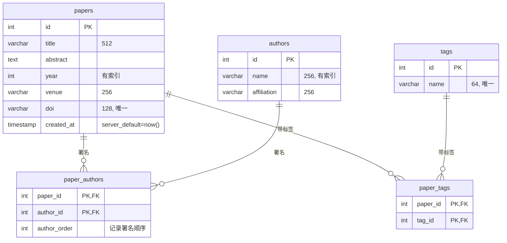
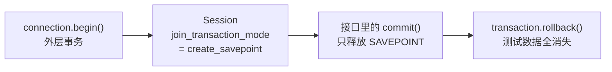

# Paper Manage API

[](https://github.com/npera2/paper_manage/actions/workflows/ci.yml)
[](#测试)
[](https://www.python.org/)

论文管理 REST API：论文的增删改查、按作者 / 年份 / 标签 / 关键词组合检索、BibTeX 批量导入。

FastAPI · PostgreSQL · SQLAlchemy 2.0 · Alembic · Docker Compose · GitHub Actions

<sub>A paper-management REST API with combined search, BibTeX import, and a fully containerized, CI-gated delivery pipeline.</sub>

> **想了解每项技术「为什么这么选、关键概念是什么、踩过什么坑」？**
> 见 **[技术栈详解 · docs/TECH_STACK.md](docs/TECH_STACK.md)** —— 39 个技术条目，每条都标注了它在本项目里的具体落点。

---

## 快速开始

只需要 Docker，不需要本地装 Python 或 PostgreSQL：

```bash
git clone https://github.com/npera2/paper_manage.git
cd paper_manage
cp .env.example .env          # 把里面的 API_KEY 改成一串你自己的随机字符串
docker compose up --build
```

打开 <http://127.0.0.1:8000/> —— 会自动跳到内置的 **Web 控制台**：填上 `API_KEY` 就能检索、新建、编辑、删除、导入 BibTeX，不用写一行 curl。

想看原始的接口文档则是 <http://127.0.0.1:8000/docs>（Swagger UI，点右上角 Authorize 填入 `API_KEY`）。

想直接灌一批数据试试（`sample_data/sample.bib` 里故意混了一条坏数据，用来看「部分失败」的表现）：

```bash
KEY=$(grep '^API_KEY=' .env | cut -d= -f2)
curl -X POST http://127.0.0.1:8000/papers/import/upload \
  -H "X-API-Key: $KEY" -F "file=@sample_data/sample.bib"
```

---

## 功能

- **论文 CRUD** —— 创建 / 查询 / 局部更新 / 删除，作者与标签以嵌套对象返回- **组合检索** —— `author`（模糊）、`year`（精确）、`tag`（精确）、`q`（标题+摘要模糊）四个条件可任意组合，按年份倒序分页
- **BibTeX 导入** —— 支持粘贴文本和上传 `.bib` 文件；基于 DOI 幂等去重（无 DOI 时用「标题 + 年份」兜底）
- **部分成功语义** —— 批量导入里一条坏数据不影响其余记录，失败明细逐条返回，不变式 `total == created + skipped + failed`
- **API Key 鉴权** —— 读公开、写需鉴权，`/docs` 上直接有 Authorize 按钮
- **统一错误响应** —— 所有 4xx/5xx 都是同一个形状，前端不用写两套解析
- **内置 Web 控制台** —— 单文件 HTML（零依赖、无构建步骤），由 API 自己托管在 `/ui`，同源所以不需要配 CORS

---

## 架构

请求自上而下穿过各层。**依赖方向永远向下、不允许回头** —— 这既是分层的意义，也是避免循环导入的根本原因。



### 数据模型

作者和标签一律用**独立表 + 关联表**，不用字符串数组或 JSON 列 —— 因为「按作者 / 标签检索」必须能走索引，而 `LIKE '%name%'` 是全表扫描加误匹配。



---

## API

| 方法 | 路径 | 鉴权 | 说明 |
|---|---|---|---|
| `GET` | `/health` | — | 健康检查 |
| `GET` | `/auth/check` | 需要 | 校验 API Key 是否有效，**无副作用** |
| `GET` | `/papers` | — | 组合检索 + 分页，返回 `{total, limit, offset, items}` |
| `GET` | `/papers/{id}` | — | 按 id 取单篇 |
| `POST` | `/papers` | 需要 | 新建论文 |
| `PATCH` | `/papers/{id}` | 需要 | 局部更新，只改传了的字段 |
| `DELETE` | `/papers/{id}` | 需要 | 删除，返回 204 |
| `POST` | `/papers/import` | 需要 | 导入 BibTeX 文本 |
| `POST` | `/papers/import/upload` | 需要 | 导入 `.bib` 文件 |

检索示例：

```bash
curl "http://127.0.0.1:8000/papers?author=zhang&year=2024&tag=glaciology&q=valley&limit=20&offset=0"
```

### 错误响应格式

```json
{
  "error": {
    "code": "validation_error",
    "message": "请求参数校验失败",
    "details": [{"field": "year", "message": "Value error, year 不能晚于 2027"}]
  }
}
```

| 状态码 | 场景 |
|---|---|
| 401 | 缺少或错误的 `X-API-Key` |
| 404 | 目标资源不存在 |
| 409 | 唯一约束冲突（例如 DOI 重复） |
| 422 | 请求体或查询参数校验失败 |

---

## 技术选型与理由

| 选型 | 为什么是它 |
|---|---|
| **FastAPI** | 原生吃 Pydantic 校验和 `Depends` 依赖注入，两条核心需求被框架直接接住；自带 OpenAPI 文档 |
| **SQLAlchemy 2.0（同步）** | 明确否决了 async。同步栈概念少、报错直观、断点好打，这个项目规模完全够用。配套纪律是接口函数也用同步 `def`，让 FastAPI 丢进线程池、不阻塞事件循环 |
| **psycopg3（`psycopg[binary]`）** | `binary` extra 自带 libpq，Windows 和 slim 镜像里都不需要装系统依赖 |
| **pydantic-settings** | 取值优先级是「环境变量 > `.env` 文件」，所以同一份代码能在本地 / 容器 / CI 三处通用 |
| **Alembic** | schema 的唯一可信来源。测试库也用同一套迁移建表，杜绝 schema 漂移 |
| **自研 BibTeX 解析器** | 只需要「取条目和字段值」，不值得为此引依赖；自己写才能把「部分失败怎么报告」设计清楚。日后若要支持 `@string` 宏展开、LaTeX 转义反解析，换成 `bibtexparser` 也来得及 |
| **关联表而非 JSON 列** | 见上文「数据模型」 |
| **ruff** | 一个工具同时做 lint 和 format，CI 里两条命令搞定 |
| **uv** | 依赖解析快、`uv.lock` 保证可复现、容器里 `uv sync --frozen` 干净利落 |
| **多阶段 Docker 构建** | builder 装依赖、runtime 只拷结果；非 root 运行；镜像 326 MB |

---

## 性能：一次索引优化的完整记录

`q` 参数做的是 `title ILIKE '%keyword%'` —— 这类查询**用不了 B-tree 索引**，因为 B-tree 只能回答「以 X 开头」。2 万行数据上的实测：

| 查询 | 执行计划 | 耗时 |
|---|---|---|
| `WHERE year = 1950`（命中 1.3%） | `Bitmap Index Scan on ix_papers_year` | **0.91 ms** |
| `WHERE year > 1900`（命中 100%） | `Seq Scan` | 4.49 ms |
| `title ILIKE '%cryoconite%'`（命中 0.25%） | `Seq Scan`（扫掉 19957 行） | **19.39 ms** |
| 同上，加 `pg_trgm` + GIN 索引后 | `Bitmap Index Scan on ix_papers_title_trgm` | **1.72 ms** |

**提速 11.3 倍。代价是索引体积从 176 kB 涨到 1544 kB（8.8 倍）** —— 这是「用索引体积和写入开销换查询速度」的具体数字，值不值取决于读写比。

两个值得记住的结论：

1. **看到 `Seq Scan` 不等于索引坏了。** 第二行那个查询命中全表，规划器是**正确地**选择了全表扫描 —— 从索引逐行回表反而更慢。先算选择性，再下判断。
2. **索引必须声明在模型里**，不能只写在迁移文件里。否则 Alembic 的 autogenerate 会把它当成「数据库里多出来的东西」，生成一个删掉它的迁移 —— 静默撤销优化，而且看起来完全正常。

复现方式：

```bash
uv run python scripts/seed_fake_data.py     # 灌 2 万行测试数据
docker exec paper-pg psql -U postgres -d paper_manage -c "VACUUM ANALYZE papers;"
docker exec paper-pg psql -U postgres -d paper_manage -c \
  "EXPLAIN ANALYZE SELECT id, title FROM papers WHERE year = 1950;"
```

---

## 工程实践

### 分层

`core/`（纯逻辑，不 import fastapi、不碰数据库）→ `schemas/`（校验与规范化，清洗只在这一层做）→ `crud/`（数据访问）→ `services/`（跨层业务编排）→ `api/routes/`（只收参数、调下层、定状态码）。

### 测试

```bash
uv run pytest                      # 126 个测试，覆盖率 100%
uv run pytest --cov-report=html    # 生成可视化报告到 htmlcov/
```

**隔离机制**：整个测试会话只在开始时建一次表；每个测试开一条连接、启一个事务但**永不提交**，被测代码里的 `session.commit()` 只会释放 SAVEPOINT。测试结束 rollback，数据一锅端 —— 平均代价只有一次 rollback，比每个测试重建 schema 快一到两个数量级。



测试库 `paper_manage_test` 与开发库物理隔离，并且**由 Alembic 迁移创建**（不是 `create_all`）—— 用 `create_all` 会让测试库的 schema 和真实部署悄悄分叉。

### 数据库迁移

```bash
uv run alembic upgrade head                       # 应用迁移
uv run alembic revision --autogenerate -m "描述"  # 生成迁移（注意要在空库上跑才准）
uv run alembic check                              # 校验模型与迁移是否同步
uv run alembic downgrade -1                       # 回滚一步
```

容器启动时会自动执行 `alembic upgrade head`，部署不需要额外步骤。

### CI

每次 push / PR 都跑：`ruff format --check` → `ruff check` → `alembic upgrade head` → `alembic check` → `pytest --cov-fail-under=100`。

用 Actions 的 service container 起一个隔离的 PostgreSQL。`alembic check` 专门用来挡住两类静默事故：**改了模型却忘记生成迁移**，以及**手写索引没声明进模型**。

---

## 项目结构

```
├── src/paper_manage/
│   ├── main.py                 # 创建 app、挂路由、注册异常处理器
│   ├── api/
│   │   ├── deps.py             # 依赖注入：SessionDep · require_api_key
│   │   └── routes/             # papers.py · imports.py
│   ├── core/                   # 纯逻辑，可脱离 HTTP 单元测试
│   │   ├── bibtex.py           # 自研 BibTeX 解析器
│   │   ├── config.py           # pydantic-settings
│   │   ├── errors.py           # 统一错误响应
│   │   └── security.py         # API Key 常数时间比对
│   ├── crud/paper.py           # 数据访问
│   ├── db/                     # DeclarativeBase（含约束命名约定）· engine / session
│   ├── models/                 # SQLAlchemy 2.0：Mapped + mapped_column
│   ├── schemas/                # Pydantic 边界模型
│   ├── services/imports.py     # BibTeX 导入编排
│   └── web/index.html          # 内置 Web 控制台（单文件，零依赖）
├── migrations/                 # Alembic 迁移（versions/ 下 2 个版本）
├── tests/                      # 9 个测试文件
├── scripts/seed_fake_data.py   # 灌测试数据，供 EXPLAIN 实验用
├── sample_data/sample.bib      # 导入功能的试用样例
├── docs/TECH_STACK.md          # 技术栈详解（每个技术的选型理由、关键概念、踩坑）
├── Dockerfile                  # 多阶段构建 + 非 root
├── docker-compose.yml          # api + db
└── alembic.ini
```

---

## 本地开发

也可以不用 Docker 起数据库，直接在宿主机跑：

```bash
uv sync                                       # 安装依赖（含 dev 组）
docker run -d --name paper-pg \
  -e POSTGRES_USER=postgres -e POSTGRES_PASSWORD=postgres \
  -e POSTGRES_DB=paper_manage -p 5432:5432 \
  -v paper-pg-data:/var/lib/postgresql/data postgres:16.2
cp .env.example .env
uv run alembic upgrade head
uv run uvicorn paper_manage.main:app --reload
```

| 命令 | 作用 |
|---|---|
| `uv run uvicorn paper_manage.main:app --reload` | 启动开发服务器 |
| `uv run pytest` | 跑测试（带覆盖率） |
| `uv run ruff format . && uv run ruff check .` | 格式化 + lint |
| `uv run alembic check` | 校验模型与迁移是否同步 |
| `docker compose up --build` | 一条命令起整套服务 |
| `docker compose down` | 停止（数据保留在具名卷里） |

`DATABASE_URL` 里的主机名请写 `127.0.0.1` 而不是 `localhost` —— 在某些环境里 `localhost` 会先解析到 IPv6 的 `::1`，而 Docker 的端口转发可能只监听 IPv4。

---

## 踩坑记录

这些是开发过程中真实踩到、并且已经固化进配置或 CI 的问题。单独记下来是因为**它们几乎都属于「不报错但行为诡异」那一类** —— 排查成本远高于普通报错。

| 现象 | 根因 | 对策 |
|---|---|---|
| 脚本静默什么都不做，退出码 0 | 从聊天窗口复制代码时 `"__main__"` 里混进了 HTML 实体 `&#8203;` | `tests/test_source_hygiene.py` 扫描不可见字符与转义残留 |
| Alembic 报 `UnicodeDecodeError: 'gbk'` | `configparser` 用系统区域编码读 `.ini`，中文 Windows 是 GBK | `alembic.ini` 保持**纯 ASCII** |
| 测试夹具传的 URL 被改回开发库，68 个测试报错 | `migrations/env.py` 无条件覆盖了 `sqlalchemy.url` | 改成只在调用方没给时才兜底 |
| `alembic check` 想删掉 GIN 索引 | 索引只在迁移里、不在模型 metadata 里 | 用 `__table_args__` 把索引声明进模型 |
| `docker build` 报找不到 `README.md` | `.dockerignore` 排掉了 `*.md`，而 `pyproject.toml` 里有 `readme = "README.md"` | 加 `!README.md` 反向包含 |
| CI 报 `unable to find version 'v10'` | `setup-uv` 从 v8 起不再发布大版本标签；**release 版本号 ≠ 可引用的 git tag** | 固定到完整版本号 `@v10.3.0` |
| 遍历 `app.routes` 看不到子路由 | 新版 FastAPI 的 `include_router` 不再把子路由铺平进 `app.routes` | 改用 `/openapi.json` 或 `app.openapi()["paths"]` |
| 改了代码但容器行为完全没变 | 容器里的源码是构建时 `COPY` 进去的，`docker compose up -d` **只重启容器、不重建镜像** | 改代码后用 `docker compose up -d --build`；开发期更推荐直接 `uv run uvicorn --reload` |

还有一条不是 bug、但值得单独记：**PostgreSQL 的事务性 DDL**。一次跑错库的迁移撞上「表已存在」而失败，但因为 PG 支持事务性 DDL，整个迁移被完整回滚，开发库的 2 万行数据毫发无伤。这是选 PostgreSQL 而非 MySQL 的一个实际好处。
