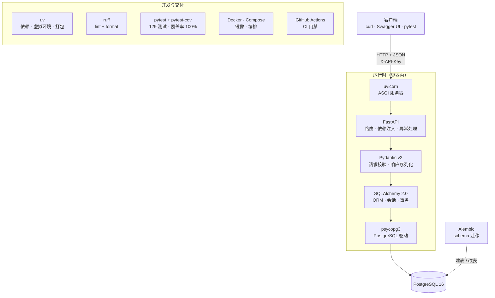

# paper_manage 技术栈详解

> 这份文档写给「想搞懂这个项目用了什么、为什么这么选、每样东西具体在干什么」的人。
>
> 每个条目都尽量标注 **用在哪**（对应哪个文件）而不是只做泛泛的技术介绍 ——
> 因为同样是「用了 SQLAlchemy」，写在哪个文件里、为什么写在那里，才是简历面试上能被追问的部分。

---

## 全景图



**一句话版本**：客户端发 HTTP → uvicorn 转成 ASGI 事件 → FastAPI 路由分发 → Pydantic 校验请求体 → SQLAlchemy 生成 SQL → psycopg3 通过 PostgreSQL 协议发给数据库 → 结果原路返回并序列化成 JSON。

---

## 目录

| 章节 | 内容 |
|---|---|
| [一](#一语言与运行时) | Python 3.12 · 现代类型注解 |
| [二](#二web-服务层) | ASGI · FastAPI · Starlette · Uvicorn |
| [三](#三数据校验与配置) | Pydantic v2 · pydantic-settings |
| [四](#四数据库与-orm) | PostgreSQL · SQLAlchemy 2.0 · psycopg3 · Alembic · 索引与执行计划 |
| [五](#五测试) | pytest · fixture · TestClient/httpx · 覆盖率 |
| [六](#六代码质量) | ruff |
| [七](#七依赖与包管理) | uv · pyproject/uv.lock · src-layout |
| [八](#八容器化) | Docker · 多阶段构建 · Compose · 容器网络与卷 |
| [九](#九cicd) | 持续集成 · GitHub Actions |
| [十](#十协议格式与规范) | REST/HTTP · OpenAPI · BibTeX · API Key |
| [十一](#十一贯穿全项目的工程概念) | 分层 · 依赖注入 · 幂等 · 部分成功 · N+1 · 事务 · 静默失败 |
| [附录 A](#附录-a技术选型决策表) | 为什么选 A 不选 B |
| [附录 B](#附录-b术语速查) | 术语表 |
| [附录 C](#附录-c按文件索引) | 文件 → 涉及的技术 |

---

## 一、语言与运行时

### 1. Python 3.12

| | |
|---|---|
| **版本** | 3.12（`.python-version` + `requires-python = ">=3.12"`） |
| **用在哪** | 整个项目 |

**为什么是 3.12 而不是 3.11 或 3.13**：3.12 提供了 `type` 语句、更好的错误信息、以及我们实际用到的 `typing.Self`；同时它的第三方生态已经全部就绪。3.13 当时还有个别库没跟上。

**项目实际用到的 3.12 特性**：

- `Self` 类型（`schemas/paper.py` 的 `model_validator` 返回值标注）
- `X | None` 联合类型写法（不再需要 `Optional[X]`）
- `list[str]` 直接下标（不再需要 `List[str]`）

### 2. 现代类型注解与 `Annotated`

| | |
|---|---|
| **用在哪** | `api/deps.py`、`api/routes/papers.py`、`core/config.py` |
| **为什么重要** | 它不只是给类型检查器看的注释，**FastAPI 会读它来决定运行时行为** |

这是本项目里最值得理解的一个「隐性语法」：

```python
# api/deps.py
SessionDep = Annotated[Session, Depends(get_db)]


# api/routes/papers.py
def search_papers(
    db: SessionDep,
    author: Annotated[str | None, Query(description="按作者名模糊匹配")] = None,
): ...
```

`Annotated[T, 元信息]` 的意思是把元信息**挂在类型上**，而不是塞进默认值。这带来两个好处：

1. **绕开了 ruff 的 B008 规则。** `def f(x: int = Depends(...))` 会被判定为「在默认参数里调用函数」，而 `Annotated` 写法天然不触发。
2. **类型检查器能看懂 `db` 就是 `Session`**。默认值写法则需要类型检查器去理解 `Depends`。

> 这是 FastAPI 官方目前推荐的写法，但网上大量教程还在用老的 `= Depends(...)`。

---

## 二、Web 服务层

### 3. ASGI

| | |
|---|---|
| **是什么** | Asynchronous Server Gateway Interface —— Python Web 服务器和应用之间的接口规范 |
| **用在哪** | 隐式：uvicorn 和 FastAPI 之间就靠它通信 |

**要理解它，得先知道它的前身 WSGI**：WSGI 定义了一个同步接口 `app(environ, start_response)`，一个请求占一个线程。ASGI 把它变成 `async def app(scope, receive, send)`，从而支持异步、WebSocket、长连接。

**本项目的特殊情况**：我们用的是**同步**数据库访问，所以虽然底下是 ASGI，我们的接口函数写的是同步 `def`：

```python
# api/routes/imports.py
@router.post("/upload", ...)
def import_from_file(db: SessionDep, file: ...) -> ImportStats:  # 注意不是 async def
    """故意用同步的 def，让 FastAPI 丢到线程池里跑，不阻塞事件循环。"""
```

**关键规则**：同步 `def` 的接口，FastAPI 会丢到线程池执行；`async def` 的接口直接在事件循环里跑。**在 `async def` 里调同步数据库会卡死整个事件循环** —— 这是同步栈必须遵守的配套纪律。

### 4. FastAPI

| | |
|---|---|
| **版本** | 0.143.0 |
| **用在哪** | `main.py`、`api/routes/*.py`、`api/deps.py` |
| **定位** | Web 框架：负责路由、依赖注入、请求解析、响应序列化、异常处理 |

**本项目实际用到它的四个能力**：

1. **路由 + 前缀分组** —— `APIRouter(prefix="/papers", tags=["papers"])`
2. **依赖注入** —— `Depends(get_db)` / `Depends(require_api_key)`，以及测试里的 `app.dependency_overrides`
3. **自动从类型注解推导参数来源** —— 路径参数、查询参数、请求体、请求头，全靠注解区分
4. **OpenAPI 自动生成** —— `/openapi.json` 和 `/docs` 零配置

**踩过的坑**：

- **路由注册顺序有讲究。** `api/routes/papers.py` 里有通配路径 `/papers/{paper_id}`，所以 `main.py` 里 `imports` 路由器**必须挂在它前面**，否则 `/papers/import` 会被当成 `paper_id="import"` 解析，直接 422。
- **新版 FastAPI 的 `include_router` 不再把子路由铺平进 `app.routes`。** 想列出所有路由要用 `/openapi.json` 或 `app.openapi()["paths"]`，遍历 `app.routes` 会看不到子路由。

### 5. Starlette

| | |
|---|---|
| **版本** | 1.7.0（FastAPI 的依赖，不是直接安装的） |
| **用在哪** | `core/errors.py` 里注册异常处理器时用到它的 `HTTPException` |

**关系**：FastAPI 建在 Starlette 之上。Starlette 提供底层的路由、中间件、请求响应对象、WebSocket；FastAPI 在上面加了依赖注入、Pydantic 集成、OpenAPI 生成。

**本项目直接用到它的地方**：

```python
# core/errors.py
from starlette.exceptions import HTTPException as StarletteHTTPException

@app.exception_handler(StarletteHTTPException)   # 注册父类，能兜住 FastAPI 的子类
```

**为什么注册的是 Starlette 的 `HTTPException` 而不是 FastAPI 的**：FastAPI 那个是它的子类。注册父类可以一次兜住两种来源的异常，包括框架内部抛的（比如路由没匹配到）。

### 6. Uvicorn

| | |
|---|---|
| **版本** | 0.54.0（装的是 `uvicorn[standard]`） |
| **用在哪** | `Dockerfile` 的 CMD、本地开发命令 |

**它干的事**：监听 TCP 端口 → 把 HTTP 报文解析成 ASGI 事件 → 交给 FastAPI → 把响应写回 socket。

**为什么装 `[standard]`**：这个 extra 带上 `uvloop`（更快的异步事件循环）、`httptools`（更快的 HTTP 解析）、`watchfiles`（`--reload` 的实现）、`websockets`。不带的话这些都是纯 Python 实现，慢得多，而且 `--reload` 会不可用。

**Dockerfile 里的一个细节**：

```dockerfile
CMD ["sh", "-c", "alembic upgrade head && exec uvicorn paper_manage.main:app ..."]
#                                    ^^^^ 不能省
```

`exec` 让 uvicorn **替换掉 shell 成为 PID 1**，这样容器收到的 `SIGTERM` 能直接传到它手上，正在处理的请求有机会做完。不加 `exec` 的话，`docker compose stop` 会退化成「等 10 秒然后强杀」。

---

## 三、数据校验与配置

### 7. Pydantic v2

| | |
|---|---|
| **版本** | 2.14.1 |
| **用在哪** | `schemas/` 整个目录 |
| **定位** | 数据校验与规范化 —— 系统边界上的守卫 |

**核心能力**：

| 能力 | 本项目示例 |
|---|---|
| 类型与范围约束 | `year: int \| None = Field(ge=1000, le=2100)` |
| 自动去空白 | `model_config = ConfigDict(str_strip_whitespace=True)` |
| 从类型注解推断可空性 | `Mapped[str]` → `NOT NULL`（SQLAlchemy 那边同理） |
| 自定义校验器 | `@field_validator("doi", mode="before")` 做 DOI 归一化 |
| 跨字段校验 | `@model_validator(mode="after")` 拒绝空 PATCH |
| ORM 对象直读 | `model_config = ConfigDict(from_attributes=True)` |

**三层 Schema 的设计**（`schemas/paper.py`）：

| 模型 | 用途 | 特点 |
|---|---|---|
| `PaperCreate` | 接收创建请求 | 校验最严，含归一化 |
| `PaperUpdate` | 接收 PATCH 请求 | **所有字段可选**，配合 `exclude_unset` 区分「没传」和「传了 null」 |
| `PaperRead` | 构造响应 | 嵌套作者和标签，`from_attributes=True` |

**为什么必须分层**：一个模型走天下会导致客户端能篡改 `id`、`created_at`；而响应里又会漏掉关联对象。

**踩过的坑**：

- `str_strip_whitespace=True` 必须和 `min_length=1` 配合才挡得住「标题只有空格」—— 单独用 `min_length` 时 `"   "` 是能通过的。
- **校验器和规范化必须放在 schema 层，不能散落在下游。** 本项目在阶段 3 做过一次正式重构：把去重和清洗从 `crud/` 上移到 `schemas/`，让下游可以无条件信任输入。清洗逻辑散在多处，迟早会出现「同一个数据走两条路结果不同」这种最难查的 bug。
- `raise ValueError("中文消息")` 会被 Pydantic 包装成 `Value error, 中文消息` 放进错误详情 —— 校验失败的提示语是给人看的，值得认真写。

### 8. pydantic-settings

| | |
|---|---|
| **版本** | 2.15.0 |
| **用在哪** | `core/config.py` |
| **定位** | 从环境变量 / `.env` 文件加载配置 |

**注意它不是 Pydantic 自带的**：v2 里 `BaseSettings` 搬到了独立的 `pydantic_settings` 包，从 `pydantic` 里 import 会失败。

**最重要的一条知识 —— 取值优先级**：

```
初始化参数  >  真实环境变量  >  .env 文件  >  字段默认值
```

**这条优先级是整个项目「一套代码三处跑」的根基**：

| 环境 | 配置来源 |
|---|---|
| 本地开发 | `.env` 文件 |
| Docker 容器 | `docker-compose.yml` 的 `environment`（无 `.env` 文件） |
| GitHub Actions | workflow 的 `env:` |

另外两个已验证的行为：

- **`.env` 文件缺失时不会报错**，只是跳过（所以 CI 里没有 `.env` 也能起）
- **`extra="ignore"`**：`.env` 里多写了键不会报错

**踩过的坑**：`env_file` 用相对路径 `".env"` 是按**进程工作目录**解析的。本项目用绝对路径 `BASE_DIR / ".env"`，其中 `BASE_DIR = Path(__file__).resolve().parents[3]`（`config.py` → `core/` → `paper_manage/` → `src/` → 项目根）。**`parents` 的下标数错一位是最常见的低级错误**。

**加的一道安全护栏**（`core/config.py`）：

```python
if value == PLACEHOLDER_API_KEY:
    raise ValueError("API_KEY 还是 .env.example 里的占位值……")
```

带着一个人人都知道的密钥安静地跑起来，比直接起不来危险得多。

---

## 四、数据库与 ORM

### 9. PostgreSQL 16

| | |
|---|---|
| **版本** | 16.2（`postgres:16.2` 镜像） |
| **用在哪** | 一个独立开发容器 `paper-pg` + compose 里的 `db` 服务 |

**为什么选 PostgreSQL 而不是 MySQL**：

1. **事务性 DDL** —— 迁移失败会整体回滚，不会留下半截 schema。本项目真的因此救回了 2 万行数据（一次跑错库的迁移撞上「表已存在」，PG 把整个迁移回滚了）。
2. **更好的索引类型** —— GIN、GiST、BRIN 等，本项目的 `pg_trgm` + GIN 依赖它。
3. **`pg_trgm` 这类 contrib 扩展开箱可用**，不用自己编译。

**本项目用到的 PG 特性**：

| 特性 | 用在哪 |
|---|---|
| `server_default=now()` | `papers.created_at` |
| `ON DELETE CASCADE` | 关联表的外键 |
| 复合主键 | `paper_authors(paper_id, author_id)` |
| GIN 索引 + `gin_trgm_ops` | `ix_papers_title_trgm` |
| `CREATE DATABASE ... WITH (FORCE)` | 测试夹具重建测试库 |
| `nulls last` | 检索排序 |
| `EXPLAIN ANALYZE` | 性能分析 |

### 10. SQLAlchemy 2.0（同步）

| | |
|---|---|
| **版本** | 2.1.4 |
| **用在哪** | `db/`、`models/`、`crud/` |
| **定位** | ORM —— 把 Python 对象和数据库表映射起来 |

**最大的知识陷阱：网上大量教程还是 1.x 写法。** 本项目一律用 2.0 风格：

```python
# models/paper.py —— 2.0 风格
class Paper(Base):
    __tablename__ = "papers"
    id: Mapped[int] = mapped_column(primary_key=True)
    title: Mapped[str] = mapped_column(String(512))
    abstract: Mapped[str | None] = mapped_column(Text)  # 可空性从注解推断
    year: Mapped[int | None] = mapped_column(Integer, index=True)
```

对比 1.x 的老写法 `id = Column(Integer, primary_key=True)` —— 混用会报很怪的错。

**核心概念**（按重要性排）：

| 概念 | 说明 | 本项目落点 |
|---|---|---|
| **Session** | 一次「工作单元」，跟踪对象变化、管理事务 | `db/session.py` |
| **`expire_on_commit=False`** | commit 后对象属性不过期，避免额外的 SELECT 和 `DetachedInstanceError` | 同上 |
| **`selectinload`** | 解决 N+1：把「每条记录单独查一次关联」变成「一条 IN 查询」 | `crud/paper.py` |
| **`relationship` + `back_populates`** | 双向关系。**`back_populates` 写的是对面类的属性名**，写错会抛 `no property 'xxx'` | `models/*.py` |
| **`secondary`** | 多对多通过中间表 | `models/associations.py` |
| **`Mapped[...]` 前向引用** | 用字符串 `"Author"` + `TYPE_CHECKING` 避免循环 import | `models/paper.py` |
| **约束命名约定** | `MetaData(naming_convention=...)` 让约束名确定化 | `db/base.py` |
| **`insert()` / `update()` Core 语句** | ORM 抽象不够用时退回手写 | `crud/_link_authors()` |
| **`create_engine` 是惰性的** | 不连库，配置错了不会立刻报错 | `db/session.py` |
| **`pool_pre_ping=True`** | 借出连接前先探活，避免「闲置一会儿后第一个请求必炸」 | 同上 |

**为什么选同步不选异步**：概念少、报错直观、断点好打，这个项目规模完全够用。代价是必须遵守「接口也用同步 `def`」的配套纪律（见 ASGI 一节）。

**约束命名约定为什么值得写**（`db/base.py`）：

```python
NAMING_CONVENTION = {
    "ix": "ix_%(column_0_label)s",
    "uq": "uq_%(table_name)s_%(column_0_name)s",
    "ck": "ck_%(table_name)s_%(constraint_name)s",
    "fk": "fk_%(table_name)s_%(column_0_name)s_%(referred_table_name)s",
    "pk": "pk_%(table_name)s",
}
```

不配的话，PostgreSQL 会给约束名自动加随机后缀，而 **Alembic 生成的迁移脚本会把这些名字写死** —— 于是同一个迁移在你机器上跑得通、到 CI 上失败。配了之后名字是 `pk_papers`、`fk_paper_authors_author_id_authors` 这种确定性的，跨环境必然一致。

### 11. psycopg3

| | |
|---|---|
| **版本** | 3.3.6，装的是 `psycopg[binary]` |
| **用在哪** | 隐式：SQLAlchemy 通过它跟 PostgreSQL 通信 |

**psycopg3 是「一个壳 + 三种实现」**：

| 实现 | 说明 | Windows / slim 镜像 |
|---|---|---|
| `psycopg_c` | C 扩展，最快 | 需要编译工具链 |
| `psycopg_binary` | 预编译，**自带 libpq** | ✅ 唯一省事的 |
| 纯 Python | 代码在，但需要**系统里有 libpq** | ❌ 默认没有 |

**本项目踩过的坑**：一开始写的是 `psycopg`（不带 extra），在 `create_engine` 时抛：

```
ImportError: no pq wrapper available.
Attempts made:
- couldn't import psycopg 'c' ...: No module named 'psycopg_c'
- couldn't import psycopg 'binary' ...: No module named 'psycopg_binary'
- couldn't import psycopg 'python' ...: libpq library not found
```

**这个报错信息本身就列出了答案**。修法是 `uv add "psycopg[binary]"` —— **引号必须加**，因为 `[binary]` 在 bash 里是通配符语法。

**连接串的格式**（`DATABASE_URL`）：

```
postgresql+psycopg://用户:密码@主机:5432/库名
              ^^^^^^^^ 必须显式写驱动
```

只写 `postgresql://` 的话，SQLAlchemy 会去找默认驱动 psycopg2，而项目没装。

### 12. Alembic

| | |
|---|---|
| **版本** | 1.20.0（**生产依赖**，不是 dev） |
| **用在哪** | `alembic.ini`、`migrations/` |
| **定位** | 数据库 schema 的版本控制 |

**它解决的问题**：schema 会变（加字段、改类型、加索引）。靠「记得手工执行过某句 SQL」来维持，迟早会漏。有了迁移，schema 变成**代码**：有版本号、能 diff、能回滚。

**四个命令**：

| 命令 | 作用 |
|---|---|
| `alembic upgrade head` | 应用所有未执行的迁移 |
| `alembic revision --autogenerate -m "描述"` | 对比模型和数据库，自动生成迁移 |
| `alembic check` | 校验模型与迁移是否同步（**CI 里的门禁**） |
| `alembic stamp head` | 只写版本号、不执行迁移（已有数据的库接入 Alembic 时用） |
| `alembic downgrade -1` | 回滚一步 |

**四条必须知道的知识**：

1. **autogenerate 是拿「模型 metadata」和「真实数据库」做 diff 的。** 所以生成初始迁移必须在**空库**上跑，否则它会认为「没有差异」，给你一个空迁移。
2. **已有数据的库接入 Alembic 要用 `stamp` 不能 `upgrade`。** 表已经存在，`upgrade` 会撞「表已存在」。
3. **迁移里手工加的索引必须同时声明进模型。** 否则 autogenerate 会把它当成「数据库里多出来的东西」，生成一个**删掉它的迁移** —— 静默撤销性能优化。
4. **测试库也用同一套迁移建表**（不用 `create_all`）。`create_all` 只按模型建表，看不到迁移里的额外对象（比如 GIN 索引），会让测试库 schema 和真实部署悄悄分叉。

**本项目踩过的三个坑**：

- **`alembic.ini` 必须纯 ASCII。** Alembic 用 `configparser.read(encoding="locale")` 读它，中文 Windows 的 locale 是 GBK，UTF-8 中文注释直接 `UnicodeDecodeError`。
- **`migrations/env.py` 注入 URL 时必须判断是否已被设置**：`if not config.get_main_option("sqlalchemy.url")`。无条件覆盖会让测试夹具传的测试库 URL 被改回开发库。
- **`fileConfig(..., disable_existing_loggers=False)`**：默认会关掉已配置的 logger，破坏 pytest 的日志捕获。

### 13. 索引与执行计划

| | |
|---|---|
| **用在哪** | `models/paper.py` 的 `index=True` / `__table_args__`、迁移 `e312e989a0f9` |

**索引类型速查**：

| 类型 | 适合 | 本项目示例 |
|---|---|---|
| **B-tree**（默认） | 等值、范围、**前缀**匹配 | `ix_papers_year`、`ix_authors_name` |
| **GIN + `pg_trgm`** | 任意位置的模糊匹配 `LIKE '%x%'` | `ix_papers_title_trgm` |
| 唯一索引 | 约束 + 查询 | `uq_papers_doi`、`uq_tags_name` |

**核心结论**：

1. **`Seq Scan` 不等于索引坏了。** 当查询命中大部分行时，全表扫描本来就更快，规划器是**正确地**选择了它。先算选择性再下判断。
2. **B-tree 只能回答「以 X 开头」。** `ILIKE '%x%'` 用不了它，只能全表扫。
3. **`pg_trgm` 把字符串切成三个字符一组建倒排索引**，所以 `%x%` 也能查。代价是索引体积大得多（本项目实测 1544 kB vs 176 kB）。

**实测数据**（2 万行）：

| 查询 | 计划 | 耗时 |
|---|---|---|
| `WHERE year = 1950`（命中 1.3%） | Bitmap Index Scan | 0.91 ms |
| `WHERE year > 1900`（命中 100%） | Seq Scan | 4.49 ms |
| `title ILIKE '%cryoconite%'` | Seq Scan | 19.39 ms |
| 同上 + GIN 索引 | Bitmap Index Scan | **1.72 ms** |

**怎么读 EXPLAIN 输出**：

```
Bitmap Index Scan on ix_papers_year  (cost=6.34..608.06 rows=265 width=76)
                                     (actual time=0.108..0.805 rows=265 loops=1)
```

| 字段 | 含义 |
|---|---|
| `cost=启动..总` | 估算代价（抽象单位，不是毫秒） |
| `rows=`（前面） | 规划器**估算**的行数 |
| `actual ... rows=` | **实际**行数 |
| 两者差很远 | 统计信息过期，跑 `ANALYZE` |
| `Execution Time` | 真实耗时 |

**别忘了 `VACUUM ANALYZE`**：不做的话规划器还在按旧统计信息做决策，EXPLAIN 结果是误导性的。

**⚠️ `EXPLAIN ANALYZE` 会真的执行查询。** 对 `INSERT/UPDATE/DELETE` 用它等于真的改数据 —— 生产库上别这么干。另外别把 `ANALYZE`（收集统计信息）和 `EXPLAIN ANALYZE`（执行并分析）搞混，名字像但作用完全不同。

---

## 五、测试

### 14. pytest

| | |
|---|---|
| **版本** | 9.1.1 |
| **用在哪** | `tests/` 目录（9 个文件，129 个测试） |

**测试分层**（这个分法值得学）：

| 文件 | 层次 | 需要数据库？ |
|---|---|---|
| `test_config.py`、`test_schemas.py`、`test_bibtex_parser.py`、`test_source_hygiene.py` | 纯单元 | ❌ 毫秒级 |
| `test_db.py` | 组件 | ✅ 但不走 HTTP |
| `test_health.py`、`test_auth.py`、`test_papers_crud.py`、`test_papers_search.py`、`test_imports.py` | 接口 | ✅ 走 ASGI |

**能写成纯单元测试的，尽量写成纯单元测试** —— 这也是「把纯逻辑下沉到 `core/`、不 import fastapi」的回报。

**常用命令行**：

```bash
uv run pytest                          # 全跑
uv run pytest tests/test_imports.py -v # 单个文件
uv run pytest -k "dedup" -v            # 名字含 dedup 的
uv run pytest --no-cov                 # 跳过覆盖率统计
uv run pytest -x                       # 第一个失败就停
```

**几个有用的机制**：

| 机制 | 用途 |
|---|---|
| `@pytest.mark.parametrize` | 一份代码测多组输入（`test_schemas.py` 的 DOI 归一化） |
| `monkeypatch` | 临时替换函数（`test_imports.py` 注入写入失败） |
| `caplog` / `capsys` | 捕获日志和输出 |
| `--strict-markers` | marker 拼错直接报错，而不是静默忽略 |

### 15. fixture 与作用域

| | |
|---|---|
| **用在哪** | `tests/conftest.py` |

**fixture 的作用域决定它被创建几次**：

| 作用域 | 创建次数 | 本项目用途 |
|---|---|---|
| `session` | 整个测试会话一次 | 建测试库、跑迁移、建 engine |
| `function`（默认） | 每个测试一次 | 数据库会话、HTTP 客户端 |

**本项目的 fixture 依赖链**：

```
test_database_url (session)
  → admin_engine (session)      连 postgres 维护库，用来建/删测试库
  → engine (session)            删库重建 + 跑 alembic 迁移 + 建 engine
  → db_session (function)       外层事务 + SAVEPOINT
  → client (function)           TestClient + dependency_overrides
```

**最难的一个点：`join_transaction_mode="create_savepoint"`**

```python
connection = engine.connect()
transaction = connection.begin()  # 外层事务，永不提交
session = Session(bind=connection, join_transaction_mode="create_savepoint")
...
transaction.rollback()  # 测试结束，数据一锅端
```

被测代码里的 `session.commit()` 只会**释放 SAVEPOINT 再开一个新的**，外层事务始终没结束。于是每个测试都从干净状态开始，平均代价只有一次 rollback。

> 这是 SQLAlchemy 2.0 的正统写法。**网上大量教程还在教 `after_transaction_end` 事件监听那套老方案**，搜到会困惑。

### 16. TestClient 与 httpx

| | |
|---|---|
| **版本** | httpx 0.28.1（TestClient 底层用它） |
| **用在哪** | 所有接口测试 |

**它不需要真的起服务器**：`TestClient(app)` 直接把请求喂给 ASGI 应用，省掉了端口、网络、进程管理的复杂度。

**关键的一行 —— `dependency_overrides`**：

```python
# tests/conftest.py
app.dependency_overrides[get_db] = override_get_db
```

**这是「鉴权做成依赖」而不是「写死在中间件」的最大回报**：

```python
# tests/test_auth.py —— 一行绕过真实鉴权
app.dependency_overrides[require_api_key] = lambda: None
```

中间件是很难这样替换的。

**踩过的坑**：`override_get_db` 必须 yield **同一个** `db_session`，不能新建。新建的话数据跑到另一条连接上：测试里查不到、回滚也回滚不掉、还会把脏数据留进测试库。这是自建 fixture 最常见的错误。

### 17. 覆盖率与 pytest-cov

| | |
|---|---|
| **版本** | pytest-cov 7.1.0 / coverage 7.16.2 |
| **用在哪** | `pyproject.toml` 的 `addopts` + CI 的 `--cov-fail-under=100` |

**配置分两处是有意的**：

```toml
# pyproject.toml —— 本地跑也统计覆盖，但不卡门槛
addopts = "-q --strict-markers --cov=paper_manage --cov-report=term-missing"
```

```yaml
# .github/workflows/ci.yml —— 门槛出现在 CI 配置里，改它是一次显式决定
run: uv run pytest --cov-fail-under=100
```

**一个必须理解的现象 —— 「被依赖覆盖遮住的缺口」**：

`db/session.py` 的 `get_db` 一度只有 64% 覆盖，因为**所有接口测试都用 `dependency_overrides` 把它换掉了**，它永远不会被执行。这不是测试写得不好，而是依赖注入的正常副作用。

补法不是「去掉覆盖」，而是**专门写一个测试直接驱动那个生成器**（`tests/test_db.py`）。

> **覆盖率缺口要先解释成因，再决定要不要补。** 盲目追数字会写出没有意义的测试。
>
> 反过来，有些分支**永远不可能自然触发**（比如 `services/imports.py` 里的写入失败分支 —— 去重逻辑太严了），这时用 `monkeypatch` 强制注入才是对的。而且它顺带验证了「失败后 rollback 能让后续记录继续导入」这个承诺是真的。

---

## 六、代码质量

### 18. ruff

| | |
|---|---|
| **版本** | 0.17.0 |
| **用在哪** | `pyproject.toml` 的 `[tool.ruff*]`、CI 的两条命令 |

**一个工具同时做 lint 和 format**（底层用 Rust 写的，比 flake8 + black + isort 的组合快一两个数量级）。

**必须分清的两件事**：

| 命令 | 管什么 | 举例 |
|---|---|---|
| `ruff check --fix` | **lint**：安全的问题修复 | import 排序、多余的 else |
| `ruff format` | **排版**：引号、缩进、换行 | 替代 black |

**日常循环**：

```bash
uv run ruff format . && uv run ruff check --fix . && uv run ruff check .
```

**`[*]` 和 `[ ]` 的区别**：`[*]` 表示可自动修复，`[ ]` 或无标记表示需要你手动改（未使用的变量、潜在逻辑 bug）。

**本项目的规则选择**：

```toml
[tool.ruff.lint]
select = ["E", "F", "I", "UP", "B", "SIM", "RUF"]
ignore = ["RUF001", "RUF002", "RUF003"]
```

| 规则集 | 抓什么 |
|---|---|
| `E` | pycodestyle 错误 |
| `F` | pyflakes：未使用变量、未定义名 |
| `I` | import 排序（isort） |
| `UP` | 语法现代化 |
| `B` | flake8-bugbear：真实 bug |
| `SIM` | 简化建议 |
| `RUF` | ruff 自家规则 |

**三条被 ignore 的规则是中文项目的标准做法**：`RUF001/002/003` 是 ambiguous-unicode-character，会把中文全角标点（`，` `：` `！`）在字符串、文档字符串、注释里全部标红。那是**正确用法，不是错误**。代价是失去「误把半角打成全角」的提醒，可接受。

**配置块的位置也是坑**：`select` / `ignore` 必须在 `[tool.ruff.lint]` 下面。老教程写在 `[tool.ruff]` 顶层，ruff 0.2 之后已废弃。

**`known-first-party = ["paper_manage"]`**：告诉 isort「`paper_manage` 是我自己的代码」。不设的话 ruff 可能把它当第三方库，混进 fastapi 那一堆里。

---

## 七、依赖与包管理

### 19. uv

| | |
|---|---|
| **版本** | 0.12.17 |
| **用在哪** | `pyproject.toml`、`uv.lock`、`Dockerfile`、CI |

**它替代了 pip + venv + pip-tools + poetry 的组合**，而且快得多。

**常用命令**：

| 命令 | 作用 |
|---|---|
| `uv add 包名` | 加一个生产依赖 |
| `uv add --dev 包名` | 加一个开发依赖 |
| `uv add "包名[extra]"` | 加带 extra 的依赖（**引号必须加**，`[]` 在 bash 里是通配符） |
| `uv remove 包名` | 移除 |
| `uv sync` | 按 lock 文件同步环境 |
| `uv run 命令` | 在项目环境里跑命令 |
| `uvx 工具名` | 临时跑一个工具，不装进项目 |

**`uv run` 的妙处**：不用手动激活虚拟环境。它会自动确保环境是最新的，然后执行命令。

### 20. pyproject.toml 与 uv.lock

| | |
|---|---|
| **用在哪** | 项目根目录 |

**两者的分工**：

| 文件 | 内容 | 要不要提交 |
|---|---|---|
| `pyproject.toml` | **你声明的约束**（`>=3.3.6`）、工具配置 | ✅ |
| `uv.lock` | **解析出的精确版本 + 哈希** | ✅（应用项目一定要提交） |

**为什么 lock 文件必须提交**：它保证「今天装」和「三个月后装」得到完全一样的依赖树。CI 里用 `uv sync --frozen` 就是强制**严格按 lock 装、绝不偷偷更新** —— lock 和 pyproject 不一致时直接失败，而不是静默修正。

**`[dependency-groups]`** 是 PEP 735 定义的开发依赖分组（本项目只用了 `dev`），比老的 `[project.optional-dependencies]` 更清晰。

### 21. src-layout

```
paper_manage/
├── pyproject.toml
├── src/
│   └── paper_manage/     ← 包在这里
└── tests/
```

**为什么不把包放在根目录**：

1. **避免「源码和装好的包同名」这类幽灵问题。** 根目录布局下，`import paper_manage` 可能拿到的是本地目录而不是 venv 里的包，取决于当前工作目录 —— 这种 bug 极难查。
2. **`uv build` 只打包 `src/paper_manage/`。** 根目录下散落的文件夹会被**静默忽略** —— 表现为「本地好、打包坏」。
3. 顶层目录干净，`tests/`、`scripts/`、`migrations/` 一眼能区分。

**本项目踩过的坑**：一开始把 `api/` `core/` `db/` 等直接放在了 `src/` 下面（而不是 `src/paper_manage/` 里）。因为可编辑安装会把整个 `src/` 加进 `sys.path`，本地居然能跑通 —— 但打包时会全部丢失。**「本地能跑」不等于「装到别处能跑」。**

**验证方法**：

```bash
uv run python -c "import paper_manage; print(paper_manage.__file__)"
# 应该打印 ...\src\paper_manage\__init__.py
```

---

## 八、容器化

### 22. Docker 与 Dockerfile

| | |
|---|---|
| **用在哪** | `Dockerfile` |

**核心概念**：

| 概念 | 说明 |
|---|---|
| **镜像 / 容器** | 镜像是只读模板，容器是它的一次运行实例 |
| **分层与缓存** | 每条指令是一层。**任何一层变了，它之后的所有层都要重建** |
| **构建上下文** | `docker build .` 里那个 `.`，默认整个目录都会发给 daemon |

**本项目 Dockerfile 的三个关键点**：

1. **先拷依赖清单、再拷源码**。这样改业务代码不会触发重新安装依赖 —— 分层缓存最值钱的地方。

```dockerfile
COPY pyproject.toml uv.lock ./
RUN uv sync --frozen --no-install-project --no-dev
COPY . .
RUN uv sync --frozen --no-dev
```

2. **非 root 运行**。`RUN useradd --create-home --uid 1000 appuser` + `USER appuser`。万一被突破，攻击面小得多。

3. **`exec` 不能省**（见 Uvicorn 一节）。

### 23. 多阶段构建

```dockerfile
FROM python:3.12-slim-bookworm AS builder    # 装依赖、编译
...
FROM python:3.12-slim-bookworm               # 从零开始，只拷结果
COPY --from=builder --chown=appuser:appuser /app /app
```

**为什么值得多写一个阶段**：构建需要的工具链、包管理器缓存、编译中间产物**都不会进最终镜像**。本项目最终镜像 326 MB，其中大部分是 Python 运行时本身。

**`--chown` 是必须的**：builder 阶段跑在 root 下，不 chown 的话运行阶段的非 root 用户读不到这些文件。

### 24. Docker Compose

```yaml
services:
  db:  ...
  api: ...
```

**它解决的问题**：把「起几个容器、怎么连、依赖顺序、端口、卷」写成一个文件，一条命令复现。没有它的话，你需要记住一长串 `docker run` 参数。

**本项目的四个关键配置**：

| 配置 | 为什么 |
|---|---|
| `depends_on: db: condition: service_healthy` | 不是「db 容器起来了」，而是「db 通过了健康检查」。api 启动第一步就是迁移，PG 没就绪会直接失败 |
| `db` 不映射端口 | api 走内部网络就够了；顺带避开和宿主机已有的 PG 抢 5432 |
| `environment` 覆盖 `env_file` | `.env` 里的 `DATABASE_URL` 写的是 `127.0.0.1`，容器里必须换成服务名 `db` |
| 具名卷 | 容器删了数据还在 |

### 25. 容器网络与数据卷

**网络**：compose 会创建一个内部网络，服务之间**用服务名当主机名**互相访问。这里有个最常见的错误：

```
容器里的 localhost 指的是「这个容器自己」，那里没有 PostgreSQL。
所以要写 @db:5432，不是 @localhost:5432。
```

**数据卷的两种写法**：

| 类型 | 写法 | 用途 |
|---|---|---|
| 具名卷 | `paper-manage-db-data:/var/lib/...` | 持久化数据。由 Docker 管理，删容器不删数据 |
| 绑定挂载 | `./src:/app/src` | 开发时挂源码进容器热重载 |

```bash
docker volume ls                    # 看有哪些卷
docker compose down                 # 停容器，卷保留
docker compose down -v              # ⚠️ 连卷一起删（数据没了）
```

**在宿主机连不上容器里的库？** 大概率是端口没映射。用：

```bash
docker compose exec db psql -U postgres -d paper_manage
```

### 26. .dockerignore

**作用**：从构建上下文里排除文件。不写它的话，`.git`、`.venv`、`__pycache__` 全都会被打进镜像（或者更糟，进构建缓存层）。

**本项目的两条关键规则**：

```
# 绝不能进镜像：里面是真实密钥。镜像的每一层都能被 pull 到的人看到。
.env
```

```
# ⚠️ 隐含依赖：pyproject.toml 里写着 readme = "README.md"，
# 所以 README.md 是构建项目元数据时必需的输入。
*.md
!README.md
```

**踩过的坑**：把 `*.md` 一刀切排除后，`uv sync` 在构建项目那一步直接失败：

```
failed to open file `/app/README.md`: No such file or directory
```

**`.dockerignore` 和 `pyproject.toml` 之间有隐含依赖，排得太狠会反过来炸自己。**

---

## 九、CI/CD

### 27. 持续集成（CI）

**概念，不是工具。** 核心是「每次改动都自动验证」，把反馈周期从几周压到几分钟。

**它的价值不是「帮我测试」，而是「阻止坏代码进主干」。** 测试是你主动去跑的；CI 是别人想合代码时**必须通过的门**。

**本项目的 CI 挡这六类问题**：

| 步骤 | 挡什么 |
|---|---|
| `ruff format --check` | 格式漂移 |
| `ruff check` | 风格与潜在 bug |
| `alembic upgrade head` | 迁移能不能在干净库上跑通 |
| `alembic check` | 模型改了但忘生成迁移 / 手写索引没进模型 |
| `pytest --cov-fail-under=100` | 逻辑回归 + 覆盖率下降 |
| `test_source_hygiene.py` | 不可见字符与转义残留 |

### 28. GitHub Actions

**概念层次**（三者常被混用，其实是三层）：

```
理念  CI 持续集成
        ↓ 需要一个平台来跑
平台  GitHub Actions
        ↓ 在它上面怎么配置
配置  workflow（.github/workflows/*.yml）
```

**workflow 的三层结构**：

```yaml
on:          # 什么时候跑
jobs:        # 跑哪些任务，各自在什么机器上
  quality:
    runs-on: ubuntu-latest
    steps:   # 一步一步做什么
      - run: uv sync --frozen
```

**几个必须知道的机制**：

| 机制 | 说明 |
|---|---|
| **runner 是全新的一次性虚拟机** | 每次运行都从空系统开始。**所以你本地跑通不代表 CI 能跑通** |
| **一个 step 失败，后面的默认不跑** | 这就是「门禁」的实现 |
| **`services:`** | 在同一个 runner 里再起容器（本项目用来提供隔离的 PostgreSQL） |
| **`concurrency` + `cancel-in-progress`** | 同分支连着 push 时取消旧运行，省额度也避免状态错乱 |
| **缓存** | 本项目用 `setup-uv` 的内置缓存，key 跟着 `uv.lock` 走 |

**引用 action 时必须验证 tag 真的存在**：

```bash
curl -s -o /dev/null -w '%{http_code}' \
  https://api.github.com/repos/<owner>/<repo>/git/ref/tags/<tag>
# 200 = 能引用；404 = 写了也是白写
```

**踩过的坑**：`astral-sh/setup-uv` **从 v8 起不再发布「跟随最新」的大版本标签**，写 `@v10` 会直接报 `unable to find version 'v10'`。**release 页面上的版本号 ≠ 可引用的 git tag**，必须用完整版本号 `@v10.3.0`。

**排查 CI 红灯的第一步**：看**失败在哪个阶段**。`Set up job` 阶段的错基本都跟配置文件有关（action 引用、权限、语法），跟你的代码无关。

---

## 十、协议、格式与规范

### 29. REST 与 HTTP 状态码

**REST 不是标准，是一组约定**：用 URL 表示资源、用 HTTP 方法表示动作、用状态码表示结果。

**本项目用到的状态码（语义要准确）**：

| 码 | 语义 | 本项目场景 |
|---|---|---|
| 200 | 成功，有响应体 | 检索、导入（部分成功也是 200） |
| 201 | 已创建 | `POST /papers` |
| 204 | 成功，无响应体 | `DELETE /papers/{id}` |
| 401 | **未认证** —— 没提供凭据或凭据无效 | 缺少/错误的 `X-API-Key` |
| 404 | 资源不存在 | 查询不存在的 id |
| 409 | 冲突 | DOI 重复（唯一约束） |
| 422 | 请求体/参数校验失败 | 年份超范围、空 PATCH |

**401 vs 403 的区别值得记**：401 是「你没告诉我你是谁」，403 是「我知道你是谁，但你没权限」。FastAPI 的 `APIKeyHeader(auto_error=True)` 默认返回 **403**，但缺少凭据应该是 **401** —— 所以本项目用 `auto_error=False` 自己控制。

> 顺带一提：`422` 的官方措辞在 RFC 9110 里从 "Unprocessable Entity" 改成了 "Unprocessable Content"，新版本 Starlette 会为老名字发弃用警告。

### 30. OpenAPI 与 Swagger UI

**OpenAPI** 是一份描述 REST API 的 JSON/YAML 规范（有哪些路径、什么参数、返回什么）。**Swagger UI** 是把那份规范渲染成可交互网页的工具。

**FastAPI 零配置生成两者**：读你的类型注解和 Pydantic 模型，自动产出。

| 路径 | 内容 |
|---|---|
| `/openapi.json` | 机器可读的规范 |
| `/docs` | Swagger UI（带 Authorize 按钮） |
| `/redoc` | 另一种风格的文档 |

**一个实用技巧**：想列出项目所有路由，读 `/openapi.json` 的 `paths`，**不要遍历 `app.routes`** —— 新版 FastAPI 的 `include_router` 不把子路由铺平进去。

### 31. BibTeX

**学术文献的标准纯文本格式**：

```bibtex
@article{paxman2023,
  title   = {Automatic mapping of {Greenland}'s subglacial valleys},
  author  = {Paxman, Guy J. G. and Zhang, Alice},
  journal = {Journal of Glaciology},
  year    = {2023},
  doi     = {10.1017/jog.2023.1},
  keywords = {glaciology, subglacial},
}
```

**语法要点**（本项目解析器要处理的部分）：

| 语法 | 说明 |
|---|---|
| `@type{key, field = value, ...}` | 条目结构；也支持圆括号 |
| 值可以是 `{...}`、`"..."`、裸数字 | 三种形式都要认 |
| **嵌套花括号要平衡** | `{The {DNA} of ice}` —— 不能遇到第一个 `}` 就结束 |
| `and` 分隔作者 | **前后必须有空白**，否则 `Anderson` 会被切开 |
| `Last, First` 要转成 `First Last` | 姓名有两种写法 |
| `%` 到行尾是注释 | **注释里经常出现 `@key` 引用**，必须跳过 |
| `@string` / `@preamble` / `@comment` | 不是文献条目，整块跳过 |

**本项目自研解析器的理由**：只需要「取条目和字段值」，不值得为此引依赖；自己写才能把「部分失败怎么报告」设计清楚。日后若要支持 `@string` 宏展开、LaTeX 转义反解析，换成 `bibtexparser` 也来得及。

### 32. API Key 鉴权

**本项目的选型**：一个固定 API Key 放在 `X-API-Key` 请求头里，「读公开、写需鉴权」。

**它和真正的认证的区别**：真实系统要有用户表、密码哈希、token 签发与过期。这里刻意从简，重点是把「依赖注入如何承载横切关注点」做对。

**两个技术细节**：

1. **用 `secrets.compare_digest` 而不是 `==`**。普通的 `==` 会在第一个不同的字符处提前返回，比较耗时随「匹配了多少前缀」变化 —— 攻击者能通过测量响应时间一个字符一个字符把 key 猜出来（时序攻击）。`compare_digest` 无论内容如何都花同样的时间。本项目转成 `bytes` 再比，避免非 ASCII 字符抛错。

2. **用 `Depends` 而不是中间件**。三个理由：
   - 中间件不知道某个路由到底需不需要鉴权，只能一刀切
   - 依赖会体现在 OpenAPI 里（`/docs` 上出现 Authorize 按钮），中间件不会
   - **测试时可以用 `dependency_overrides` 精确替换掉某一条**，中间件很难替换

---

## 十一、贯穿全项目的工程概念

### 33. 分层架构与依赖方向

```
api/routes/   只收参数、调下层、定状态码
    ↓
schemas/      校验 + 规范化（清洗只在这一层做）
    ↓
services/     跨层业务编排
    ↓
crud/         数据访问
    ↓
models/       ORM 映射
```

**核心规则：依赖方向永远向下，不允许回头。**

这不只是「整洁」的问题 —— 它是**避免循环导入的根本原因**。`main.py` 认识 `papers`，`papers` 完全不认识 `main`。反过来写会抛：

```
ImportError: cannot import name 'app' from partially initialized module
```

**`core/` 的定位**：纯逻辑，**不 import fastapi、不碰数据库**。所以 `core/bibtex.py` 能被喂字符串直接单元测试，不需要起服务、不需要连库。

### 34. 依赖注入（DI）

**一句话**：调用方不自己创建依赖，而是**声明「我需要什么」**，由框架提供。

```python
# 路由不关心 session 怎么来的
def search_papers(db: SessionDep, ...): ...
```

**它带来的四个实际好处**：

| 好处 | 本项目体现 |
|---|---|
| 解耦 | 路由不 import `SessionLocal` |
| 可替换 | 测试里 `dependency_overrides[get_db] = ...` |
| 可组合 | `require_api_key` 依赖 `APIKeyHeader`，形成依赖链 |
| 声明即文档 | `/docs` 上自动出现 Authorize 按钮 |

### 35. 幂等性

**定义**：同一个操作执行一次和执行多次，结果相同。

**为什么批量导入必须有它**：用户不知道自己导过没有，会重复导。

**本项目的去重策略**：

1. **DOI 优先** —— DOI 是文献的唯一标识
2. **无 DOI 时用 `(title, year)` 兜底** —— 不完美，但比每次重复插入好
3. **同时比对两个地方**：库里已有的，以及**同一份文件里前面出现过的**。只看库不看文件的话，同一份 `.bib` 里的重复条目会被插两次。

### 36. 部分成功（Partial Success）

**批量接口的两种设计**：

| 方案 | 行为 | 适用 |
|---|---|---|
| 全有或全无 | 一条失败全部回滚 | 强事务性场景（转账） |
| **部分成功** | 好的进库，坏的报错 | **批量导入**（本项目） |

**为什么导入选部分成功**：用户不该因为文件里有一条 typo 就丢掉另外 499 条。

**本项目的不变式**：

```
total == created + skipped + failed
```

每条解析出来的记录必然落到三个桶之一。这个等式是自检用的 —— 哪天它不成立了，说明分支逻辑漏了情况。

**失败明细要返回给用户**，不能只给一个计数。批量导入最难受的体验是「有 3 条失败了，但不知道是哪 3 条」。

### 37. N+1 问题

**现象**：查 20 篇论文，访问每篇的 `.authors` 都会单独发一条 SQL —— 一共 `1 + 20 + 20 = 41` 条。

**本项目实测**：不做处理时 `GET /papers?limit=20` 发 41 条 SQL；加上 `selectinload` 后固定 3 条（主查询 + authors 的 IN 查询 + tags 的 IN 查询）。

**做法**：

```python
# crud/paper.py —— 统一的加载选项
_PAPER_LOAD_OPTIONS = (
    selectinload(Paper.authors),
    selectinload(Paper.tags),
)
```

**验证方法**：把 `db/session.py` 的 `echo` 改成 `True`，跑一次请求，数 SQL 条数。**这是学 ORM 最快的方法。**

### 38. 事务与 SAVEPOINT

**事务**：一组要么全成功、要么全失败的操作。

**两条必须遵守的边界规则**（本项目踩过其中的坑）：

1. **`get_db` 依赖里不要 commit。** 事务边界属于业务逻辑，由接口层或 CRUD 层决定。这条边界划错，会写出「接口报错了但数据已经写进去了」的 bug。
2. **出错后必须先 `rollback()` 再继续。** session 出错后处于不可用状态，不回滚的话后面每一条都会连着失败。这就是为什么 `services/imports.py` 的 except 分支里第一件事是 `db.rollback()`。

**SAVEPOINT** 用于嵌套事务。本项目的两个用途：

- **测试隔离**：`join_transaction_mode="create_savepoint"`（见 fixture 一节）
- **行级锁**：`SELECT ... FOR UPDATE`

### 39. 静默失败 vs 响亮的失败

**这是本项目最重要的一条工程原则**，因为它决定了「什么问题该提前告知、什么问题该自己撞」。

| 类型 | 特征 | 处理方式 |
|---|---|---|
| **静默失败** | 不报错、行为诡异、无从查起 | **必须提前预防**（加检查、加护栏） |
| **响亮的失败** | 抛异常、有堆栈 | **留着让它自己撞** —— 报错本身就是最好的教材 |

**本项目的静默失败清单**（每一个都真的踩过）：

| 现象 | 根因 | 现在的防线 |
|---|---|---|
| 脚本静默什么都不做，退出码 0 | `"__main__"` 里混进了 HTML 实体 `&#8203;` | `tests/test_source_hygiene.py` |
| 数据库表凭空少了几张 | `models/__init__.py` 漏 import 某个模型 | 该文件显式 import 全部模型 |
| API Key 没换，服务照常启动 | 配置是占位值 | `core/config.py` 的护栏，直接拒绝启动 |
| Alembic 生成的迁移要删掉索引 | 索引只在迁移里、不在模型 metadata 里 | `alembic check` 进 CI |
| 测试库 schema 和真实部署分叉 | 用 `create_all` 而不是迁移建表 | 测试夹具改用 `alembic upgrade head` |

**注意这些防线的共同特点**：它们都是把「沉默」变成「响亮的报错」。

> 你不可能靠"小心"避免静默失败 —— 你能做的只有：**踩过一次之后，把它变成一条自动化的检查。**

---

## 附录 A：技术选型决策表

| 决策点 | 选了 | 没选 | 理由 |
|---|---|---|---|
| Web 框架 | FastAPI | Flask / Django | 原生吃 Pydantic 和 DI，两条核心需求被框架直接接住 |
| 数据库访问 | **同步** SQLAlchemy 2.0 | async SQLAlchemy | 同步栈概念少、报错直观、断点好打；代价是不能在 `async def` 里用，需要配套纪律 |
| 驱动 | `psycopg[binary]` | psycopg2 / asyncpg | psycopg3 是 psycopg2 的官方继任者；`binary` extra 自带 libpq |
| 数据库 | PostgreSQL | MySQL / SQLite | 事务性 DDL（迁移失败能回滚）、GIN 索引、contrib 扩展 |
| 配置 | pydantic-settings | 手写 `os.environ` | 环境变量 > `.env` 的优先级天然支持三处通用；有类型校验 |
| Schema 管理 | Alembic | `create_all` | `create_all` 只建不存在的表，绝不改已存在的表结构；迁移有版本、能 diff、能回滚 |
| 作者/标签建模 | 独立表 + 关联表 | JSON 列 / 字符串数组 | 「按作者/标签检索」必须能走索引，`LIKE '%name%'` 是全表扫描加误匹配 |
| BibTeX 解析 | 自研 | `bibtexparser` | 只需取条目和字段值；自己写才能把「部分失败」设计清楚 |
| 测试隔离 | 外层事务 + SAVEPOINT | 每个测试重建 schema | 快一到两个数量级 |
| 测试库建表 | Alembic 迁移 | `create_all` | 用 `create_all` 会让测试库 schema 和真实部署悄悄分叉 |
| lint + format | ruff | flake8 + black + isort | 一个工具、快一两个数量级、配置只有一处 |
| 包管理 | uv | pip + poetry | 快得多，lock 文件严格可复现，容器里 `--frozen` 干净利落 |
| 容器基础镜像 | `python:3.12-slim` | `alpine` / `full` | alpine 的 musl libc 会让预编译 wheel 用不了；full 体积大几百 MB |
| db 端口 | **不映射** | 映射到宿主机 | api 走内部网络就够了；最小暴露面 |
| 鉴权 | `Depends` + `X-API-Key` | 中间件 / JWT | 依赖可被 OpenAPI 描述、可被测试替换；JWT 对单用户项目是过度设计 |
| 错误格式 | 统一 `{"error": {...}}` | 默认 `{"detail": ...}` | 前端不用为「校验失败」和「HTTP 异常」写两套解析 |

---

## 附录 B：术语速查

| 术语 | 一句话解释 |
|---|---|
| **ASGI** | Python 异步 Web 服务器与应用之间的接口规范 |
| **迁移（migration）** | 描述 schema 变更的、带版本号的代码文件 |
| **SAVEPOINT** | 事务内部的「存档点」，可以只回滚到它 |
| **N+1** | 查 N 条记录却发了 N+1 次查询的反模式 |
| **幂等** | 同一操作执行一次和多次结果相同 |
| **部分成功** | 批量操作中部分记录成功、部分失败，明细返回给调用方 |
| **幂等键 / 指纹** | 用来判断「这条数据是不是已经有了」的字段组合 |
| **依赖注入** | 调用方声明需要什么，由框架提供，而不是自己创建 |
| **DI 覆盖** | `app.dependency_overrides`，测试里替换依赖的机制 |
| **约定优于配置** | 用命名约定替代显式配置（如约束命名、路由分组） |
| **执行计划** | 数据库对一条 SQL 打算怎么执行（走索引 / 全表扫） |
| **选择性** | 一个条件能筛掉多少行。选择性越高（命中越少），索引越可能被用上 |
| **B-tree / GIN** | 两种索引结构：前者适合前缀和范围，后者适合全文和模糊 |
| **容器 / 镜像 / 卷** | 镜像是模板，容器是实例，卷是持久化的数据 |
| **多阶段构建** | Dockerfile 里用多个 `FROM`，让构建工具链不进最终镜像 |
| **构建上下文** | `docker build .` 里的 `.`，会被传给 daemon，`.dockerignore` 控制其中哪些被排除 |
| **runner** | CI 里执行你 workflow 的那台（通常是全新的）机器 |
| **service container** | CI 里和你的 job 同网络起的辅助容器（本项目用来提供 PostgreSQL） |
| **门禁（gate）** | 必须通过才能合代码的检查 |
| **幂等去重** | 重复导入不会产生重复数据 |

---

## 附录 C：按文件索引

| 文件 | 涉及的技术与概念 |
|---|---|
| `pyproject.toml` | uv · PEP 621 · PEP 735 · ruff 配置 · pytest 配置 |
| `uv.lock` | 依赖锁定与哈希校验 |
| `src/paper_manage/main.py` | FastAPI 应用装配 · 路由注册顺序 · 异常处理器注册 |
| `api/deps.py` | 依赖注入 · `Annotated` · `APIKeyHeader` |
| `api/routes/papers.py` | APIRouter · 路径/查询参数 · 状态码 · `HTTPException` |
| `api/routes/imports.py` | 文件上传 · `python-multipart` · 同步 `def` 与线程池 |
| `core/bibtex.py` | 自研解析器 · 括号平衡 · 正则 · 部分失败设计 |
| `core/config.py` | pydantic-settings · 取值优先级 · 安全护栏 |
| `core/errors.py` | 全局异常处理器 · 统一错误格式 · 数据库异常 → HTTP 语义 |
| `core/security.py` | `secrets.compare_digest` · 时序攻击 |
| `db/base.py` | `DeclarativeBase` · `MetaData(naming_convention=...)` |
| `db/session.py` | `create_engine` 惰性 · 连接池 · `expire_on_commit` · 生成器依赖 |
| `models/paper.py` | SQLAlchemy 2.0 `Mapped` · `relationship` · `secondary` · `__table_args__` · GIN 索引 |
| `models/associations.py` | `Table` 对象 · 复合主键 · `ON DELETE CASCADE` |
| `schemas/paper.py` | Pydantic 校验器 · `field_validator` · `model_validator` · 归一化 |
| `crud/paper.py` | 查询拼装 · `selectinload` · 分页排序 · Core `insert` |
| `services/imports.py` | 业务编排 · 批量去重 · 事务回滚 · 部分成功 |
| `alembic.ini` | Alembic 配置（**纯 ASCII**） |
| `migrations/env.py` | 迁移运行环境 · URL 注入优先级 · 日志配置 |
| `migrations/versions/*.py` | 迁移脚本 · `op.create_table` · `op.create_index` |
| `tests/conftest.py` | pytest fixture 分层 · 事务隔离 · `dependency_overrides` |
| `tests/test_source_hygiene.py` | 不可见字符扫描 · 自指问题 |
| `Dockerfile` | 多阶段构建 · 非 root · 分层缓存 · `exec` |
| `.dockerignore` | 构建上下文控制 · 与 pyproject 的隐含依赖 |
| `docker-compose.yml` | 服务编排 · healthcheck · 内部网络 · 具名卷 |
| `.github/workflows/ci.yml` | GitHub Actions · service container · 缓存 · 覆盖率门禁 |
